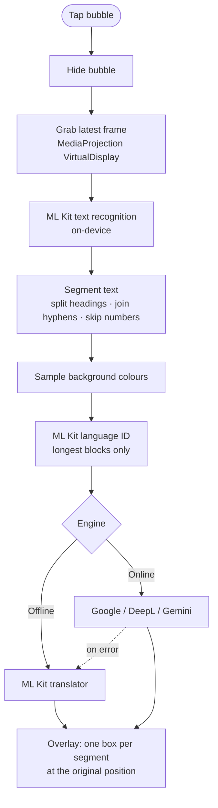

<div align="center">


# ScreenLingo

**Translate anything on your Android screen, right where it is.**

Tap the floating bubble in any app. ScreenLingo reads the text, translates it,<br>
and paints the translation over the original, in the page's own colours.

[](https://github.com/Hafij-DEU/live-translate/releases/latest)
[](https://github.com/Hafij-DEU/live-translate/releases)
[](#install)
[](#build-from-source)
[](https://developers.google.com/ml-kit)
[](#privacy)

[**⬇ Download APK**](https://github.com/Hafij-DEU/live-translate/releases/latest) · [Features](#features) · [Engines](#translation-engines) · [Languages](#language-support) · [Build](#build-from-source) · [FAQ](#troubleshooting)

</div>

---

## Highlights

|  |  |
|---|---|
| 🫧 **One tap, any app** | A floating bubble, a Quick Settings tile and a notification button all translate the current screen. |
| 🎨 **In-place overlay** | Each translation sits exactly over the text it replaces, on the same background colour, with readable contrast. |
| 🔒 **Private by default** | Text recognition and the default translator run on the phone. Nothing leaves the device unless you pick an online engine. |
| 🧠 **Four engines** | Offline ML Kit, Google Translate, DeepL or Gemini AI, with automatic fallback to offline if an online engine fails. |
| 🔎 **Auto-detect** | Detects the screen's language from its main text, ignoring short buttons and labels. |
| 🚫 **No catch** | No ads, no tracking, no accounts, no in-app purchases. |

## Features

- **Floating bubble.** Tap to translate, drag to move (the position is remembered), long-press to stop.
- **Quick Settings tile.** *Translate screen* starts the bubble, or translates straight away when it's already running.
- **Notification controls.** The ongoing notification has **Translate** and **Stop** buttons.
- **On-device OCR.** Google ML Kit text recognition for Latin, Chinese, Devanagari, Japanese and Korean, bundled in the APK.
- **Smart segmenting.** Headings are split from body text, words hyphenated across lines are rejoined, and prices or page numbers are left untouched.
- **Background-matched boxes.** Each box samples the colour around the original text and picks dark or light text to suit.
- **Copy.** Long-press the translation to copy all of it.
- **Rotation aware.** Portrait and landscape both work; the capture resizes itself.

## Install

1. Download `ScreenLingo-<version>.apk` from the [latest release](https://github.com/Hafij-DEU/live-translate/releases/latest).
2. Open it on your phone and allow your browser or file manager to install apps if asked.
3. *(Optional)* Verify the download against `SHA256SUMS` from the same release:

   ```bash
   sha256sum -c SHA256SUMS
   ```

> [!NOTE]
> Requires **Android 10 (API 29) or newer** on an **arm64-v8a** or **x86_64** device.

> [!TIP]
> To update, install the new APK over the old one. Settings and language packs are kept. The bubble stops during the update, so start it again afterwards.

## Quick start

1. Open **ScreenLingo**.
2. Pick **Translate from** (or keep *Auto-detect*) and **Translate to**.
3. Pick the **Text recognition script** for the text you'll read. Choosing a source language selects it for you.
4. Pick a **Translation engine**. *Offline* works immediately; online engines are explained [below](#translation-engines).
5. Tap **Start floating bubble**, allow **Display over other apps**, then tap it again.
6. Allow notifications *(optional)*.
7. When Android asks to share your screen, choose **Entire screen** → **Start**.

The blue bubble now floats above every app.

### Controls

| Do this | And this happens |
|---|---|
| Tap the bubble | Translates the whole screen. The bubble hides for a moment so it isn't captured. |
| Tap the translation | Closes it; the bubble returns. |
| Long-press the translation | Copies all translated text. |
| Drag the bubble | Moves it. |
| Long-press the bubble | Stops ScreenLingo. |
| Quick Settings tile | Starts the bubble, or translates if it's already running. |
| Notification → **Translate** / **Stop** | Translates the screen / stops ScreenLingo. |

> [!TIP]
> Add the tile from Quick Settings → edit (pencil) → drag **Translate screen** into your tiles.

## Translation engines

Choose one under **Translation engine** in the app.

| Engine | Quality | Speed | Needs internet | Needs a key | Cost |
|---|:---:|:---:|:---:|:---:|---|
| **Offline (ML Kit)** | ★★☆☆ | ⚡ Fast | Only for language packs | — | Free |
| **Google Translate** | ★★★☆ | ⚡ Fast | ✓ | — | Free |
| **DeepL** | ★★★★ | ⚡ Fast | ✓ | ✓ | Free tier: 500,000 characters/month |
| **Gemini AI** | ★★★★ | A few seconds | ✓ | ✓ | Free tier available |

> [!IMPORTANT]
> If an online engine fails (no connection, bad key, rate limit, unsupported language), ScreenLingo shows the reason and **falls back to the offline engine automatically**, so you always get a translation.

<details>
<summary><b>Offline (ML Kit)</b>: default, private</summary>

Translation runs entirely on the phone with Google ML Kit's on-device models. Nothing leaves the device.

Each language other than English needs a ~30 MB language pack. Packs download automatically the first time a language is used, or ahead of time with **Download offline language packs**. After that, translation works with no connection at all.

The models are compact, so translations can be literal or occasionally wrong.
</details>

<details>
<summary><b>Google Translate</b>: no setup</summary>

Uses Google Translate's public web endpoint (the one used by Google's Chrome extension). No key or account is needed.

The endpoint is unofficial, so Google may rate-limit or change it without notice. ScreenLingo falls back to offline when that happens.
</details>

<details>
<summary><b>DeepL</b>: high accuracy, your own key</summary>

1. Create a free account at <https://www.deepl.com/pro-api>.
2. Copy your **Authentication Key**.
3. Paste it into **DeepL API key** in ScreenLingo.

Free keys end in `:fx` and use DeepL's free API; other keys use the Pro API automatically. DeepL supports fewer target languages than ML Kit; unsupported ones fall back to offline.
</details>

<details>
<summary><b>Gemini AI</b>: best quality, context-aware</summary>

Gemini receives every text block on the screen at once, so it translates with full context, picks the right meaning for single words, and quietly fixes OCR mistakes.

1. Get a free API key at <https://aistudio.google.com/apikey>.
2. Paste it into **Gemini API key** in ScreenLingo.
3. *(Optional)* Set **Gemini model**. The default is `gemini-flash-latest`; any Gemini API model name works, for example `gemini-2.5-flash`.
</details>

> [!NOTE]
> API keys are stored only in the app's private storage and are excluded from Android backups.

## Language support

ScreenLingo works in two steps, reading and translating, and each step supports a different set of languages.

### Reading text (OCR)

| Script | Languages |
|---|---|
| **Latin** | English, Spanish, French, German, Italian, Portuguese, Turkish, Indonesian, Vietnamese, Polish, Dutch, Swedish and other Latin-alphabet languages |
| **Chinese** | Simplified and Traditional Chinese |
| **Devanagari** | Hindi, Marathi, Nepali |
| **Japanese** | Japanese |
| **Korean** | Korean |

### Translating

All engines can translate into ML Kit's **59 languages**.

<details>
<summary>Show all 59 languages</summary>

Afrikaans · Albanian · Arabic · Belarusian · Bengali · Bulgarian · Catalan · Chinese · Croatian · Czech · Danish · Dutch · English · Esperanto · Estonian · Finnish · French · Galician · Georgian · German · Greek · Gujarati · Haitian Creole · Hebrew · Hindi · Hungarian · Icelandic · Indonesian · Irish · Italian · Japanese · Kannada · Korean · Latvian · Lithuanian · Macedonian · Malay · Maltese · Marathi · Norwegian · Persian · Polish · Portuguese · Romanian · Russian · Slovak · Slovenian · Spanish · Swahili · Swedish · Tagalog · Tamil · Telugu · Thai · Turkish · Ukrainian · Urdu · Vietnamese · Welsh
</details>

### In practice

| Language group | Translate **from** it | Translate **into** it |
|---|:---:|:---:|
| Latin-alphabet languages (~40) | ✅ | ✅ |
| Chinese, Japanese, Korean, Hindi, Marathi | ✅ | ✅ |
| Arabic, Belarusian, Bengali, Bulgarian, Georgian, Greek, Gujarati, Hebrew, Kannada, Macedonian, Persian, Russian, Tamil, Telugu, Thai, Ukrainian, Urdu | ❌ *can't be read yet* | ✅ |

> [!NOTE]
> *English → Bengali* works, but *Bengali on screen → English* doesn't, because ML Kit can't read Bengali script.

## Permissions

| Permission | Why it's needed |
|---|---|
| **Display over other apps** | Draws the bubble and the translation overlay. |
| **Screen capture** (MediaProjection) | Captures the screen when you tap the bubble. Android asks each time the bubble starts. |
| **Foreground service** | Keeps the capture session alive while you use other apps. |
| **Notifications** *(optional)* | Shows the ongoing notification with Translate and Stop buttons. |
| **Internet** | Downloads offline language packs and reaches online engines. |

ScreenLingo does **not** use accessibility services, does **not** read your notifications, and does **not** run while the bubble is stopped.

## Privacy

- **Screenshots never leave the phone.** Each capture is processed in memory for text recognition and then discarded; nothing is saved.
- **Offline engine:** nothing is sent anywhere.
- **Online engines:** only the *recognised text* is sent, to the provider you chose (Google, DeepL or Google Gemini), under that provider's terms.
- No analytics, no ads, no accounts, no ScreenLingo servers.

> [!WARNING]
> Use the offline engine on screens showing passwords, messages or other sensitive text. The online engines send the text they read to a third-party service.

## How it works



- One `VirtualDisplay` lives for the whole session, since Android 14+ allows only one per screen-capture grant. On rotation it is resized, not recreated.
- The newest frame is always kept, so capturing works even on a screen that hasn't changed.
- The overlay works in screen coordinates, so it lines up with the original text regardless of status-bar or display-cutout insets.

## Build from source

### Requirements

| Tool | Version |
|---|---|
| JDK | 17 |
| Android SDK | platform `android-35`, build-tools 35 |
| Gradle | 8.9+ (no wrapper is committed) |
| Network | needed on the first build to fetch ML Kit from Google Maven |

### Debug build

```bash
git clone https://github.com/Hafij-DEU/live-translate.git
```

```bash
cd live-translate
```

```bash
echo "sdk.dir=$HOME/Android/Sdk" > local.properties
```

```bash
gradle assembleDebug
```

The output is `app/build/outputs/apk/debug/app-debug.apk`, signed with the Android debug key.

<details>
<summary><b>Signed release build</b></summary>

Release signing comes from environment variables, so no keystore or password is ever stored in the repository.

| Variable | Meaning |
|---|---|
| `SCREENLINGO_KEYSTORE` | Path to the `.jks` keystore |
| `SCREENLINGO_KEYSTORE_PASSWORD` | Keystore password |
| `SCREENLINGO_KEY_ALIAS` | Key alias |
| `SCREENLINGO_KEY_PASSWORD` | Key password |

Create a keystore once:

```bash
keytool -genkeypair -keystore screenlingo-release.jks -storetype PKCS12 -alias screenlingo -keyalg RSA -keysize 4096 -validity 36500
```

Set the four variables, then build:

```bash
gradle assembleRelease
```

The signed, minified APK is written to `app/build/outputs/apk/release/app-release.apk`. Without the variables, Gradle writes an unsigned `app-release-unsigned.apk` instead.

> [!CAUTION]
> Back up your keystore. Android only installs an update signed with the same key as the installed version.
</details>

<details>
<summary><b>Install with adb</b></summary>

```bash
adb install -r app/build/outputs/apk/release/app-release.apk
```
</details>

### Project structure

```text
app/src/main/java/com/hafij/screenlingo/
├── MainActivity.java        Settings: languages, script, engine, API keys
├── ProjectionActivity.java  Invisible trampoline for overlay, notification and capture consent
├── TranslateService.java    Foreground service: capture, OCR, translation, bubble, overlay
├── QuickTile.java           Quick Settings tile
├── Ocr.java                 ML Kit text recognisers per script
├── Segments.java            Turns OCR blocks into clean translation units
├── TranslateEngine.java     Offline ML Kit translation and language identification
├── OnlineTranslator.java    Google, DeepL and Gemini clients
├── ResultView.java          Draws translations over the original text
├── Languages.java           Language list, display names, OCR script hints
└── Prefs.java               Settings storage
```

Plain Java on the Android framework, with no AndroidX UI libraries. The only dependencies are ML Kit text recognition, translation and language identification.

## Troubleshooting

<details>
<summary><b>The bubble disappeared</b></summary>

Android ends screen capture when the phone locks and when the app is updated. Open ScreenLingo and tap **Start floating bubble** again.
</details>

<details>
<summary><b>"No text found on screen"</b></summary>

The selected **Text recognition script** may not match the text, or the text may be in a [script that can't be read yet](#reading-text-ocr). Pick the matching script.
</details>

<details>
<summary><b>Nothing was translated / the text stayed the same</b></summary>

Auto-detect may have judged the text to already be in the target language. Set **Translate from** to the actual language.
</details>

<details>
<summary><b>"Couldn't detect the language"</b></summary>

There was too little text to identify it. Set **Translate from** manually.
</details>

<details>
<summary><b>"Online translation failed (…). Used offline instead."</b></summary>

The message gives the reason: no internet, a missing or invalid API key, an unsupported language, or rate limiting. The offline result is shown in the meantime.
</details>

<details>
<summary><b>The first translation is slow</b></summary>

The offline language pack (~30 MB) is downloading. Later translations take a few seconds or less. Use **Download offline language packs** to fetch them in advance.
</details>

<details>
<summary><b>Only one app is captured, or the capture is black</b></summary>

When Android asks to share the screen, choose **Entire screen**, not a single app. Some apps, such as banking apps and DRM video, block screen capture entirely.
</details>

<details>
<summary><b>Xiaomi / HyperOS: <code>INSTALL_FAILED_USER_RESTRICTED</code> with adb</b></summary>

Enable **Settings → Additional settings → Developer options → Install via USB** (it needs a signed-in Mi account), or install the APK from the phone's file manager.
</details>

## Known limitations

- OCR covers the Latin, Chinese, Devanagari, Japanese and Korean scripts only.
- Very small, stylised or low-contrast text may be misread; Gemini corrects many of these errors.
- The overlay is a snapshot and doesn't follow scrolling. Close it and translate again.
- The Google engine relies on an unofficial endpoint that may stop working without notice.
- Moving content, such as video, can shift between capture and display.

## Credits

- [Google ML Kit](https://developers.google.com/ml-kit): text recognition, on-device translation and language identification
- [Material Icons](https://fonts.google.com/icons) *translate* glyph (Apache License 2.0): app icon and bubble
- [DeepL API](https://www.deepl.com/pro-api) and [Gemini API](https://ai.google.dev/): optional online engines
